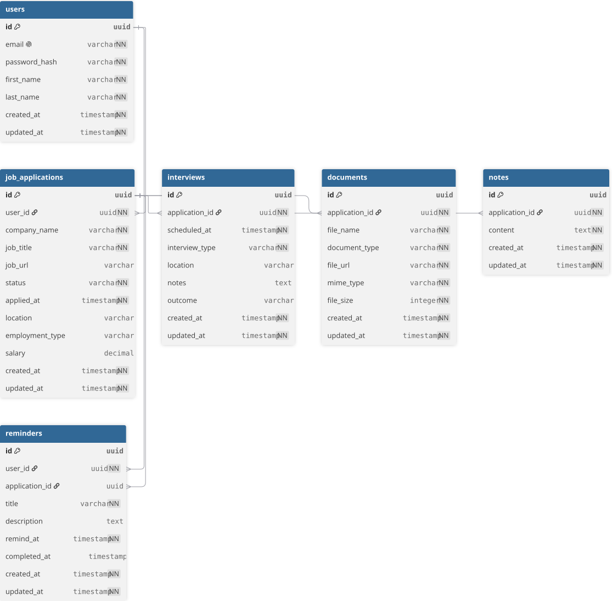

# Rolexa Database Design

## 1. Overview

This document defines the database design for Rolexa.

Rolexa is a career management platform that enables job seekers to manage job applications, interviews, documents, notes, reminders, and career progress.

The database is designed from the approved project requirements and system architecture established during Phases 1 and 2.

The database design is intended to provide:

- Clear data ownership
- Referential integrity
- Maintainability
- Secure user-data isolation
- Support for application and interview tracking
- Support for search, filtering, and dashboard analytics
- A foundation for future feature expansion

---

## 2. Database Objectives

The Rolexa database shall:

1. Persist user account and profile information.
2. Persist job application information.
3. Track application statuses and important dates.
4. Store application-related notes.
5. Store interview schedules, details, and outcomes.
6. Store document metadata associated with job applications.
7. Store user reminders and optional application associations.
8. Enforce relationships between related records.
9. Protect data ownership through a clear user ownership model.
10. Support efficient querying for application management, search, filtering, and dashboard statistics.
11. Remain maintainable as Rolexa grows.

---

## 3. PostgreSQL Decision

Rolexa will use PostgreSQL as its relational database management system.

PostgreSQL was selected as part of the approved technology stack and system architecture.

The backend architecture communicates with PostgreSQL through the Repository layer:

```text
Route
  ↓
Controller
  ↓
Service
  ↓
Repository
  ↓
PostgreSQL
```

The Repository layer is responsible for database access, while business rules remain in the Service layer.

### Why PostgreSQL?

PostgreSQL provides:

- Relational data modelling
- Strong referential integrity
- Primary and foreign key constraints
- Transaction support
- Mature indexing capabilities
- SQL querying
- Support for future application growth

---

## 4. Database Entities

The initial Rolexa database contains six core entities:

1. User
2. Job Application
3. Interview
4. Document
5. Note
6. Reminder

### 4.1 User

Represents a Rolexa user account and profile.

### 4.2 Job Application

Represents a job opportunity that a user is tracking.

### 4.3 Interview

Represents an interview associated with a job application.

### 4.4 Document

Represents metadata for a document associated with a job application, such as a CV or cover letter.

### 4.5 Note

Represents a note associated with a job application.

### 4.6 Reminder

Represents a reminder owned by a user. A reminder may optionally be associated with a specific job application.

---

## 5. Entity Attributes

The following attributes represent the current database design.

Candidate attributes that are not explicitly required by the MVP are identified separately and should not be treated as mandatory requirements without an explicit product decision.

### 5.1 Users

| Column | Required | Description |
|---|---|---|
| `id` | Yes | Unique user identifier |
| `email` | Yes | User login/account email |
| `password_hash` | Yes | Secure representation of the user's password |
| `first_name` | Yes | User first name |
| `last_name` | Yes | User last name |
| `created_at` | Yes | Record creation timestamp |
| `updated_at` | Yes | Last modification timestamp |

### 5.2 Job Applications

| Column | Required | Description |
|---|---|---|
| `id` | Yes | Unique application identifier |
| `user_id` | Yes | User who owns the application |
| `company_name` | Yes | Company associated with the application |
| `job_title` | Yes | Position applied for |
| `job_url` | No | URL of the original job posting |
| `status` | Yes | Current application status |
| `applied_at` | Yes | Date/time the application was submitted |
| `location` | Optional candidate | Job location |
| `employment_type` | Optional candidate | Employment type |
| `salary` | Optional candidate | Salary information |
| `created_at` | Yes | Record creation timestamp |
| `updated_at` | Yes | Last modification timestamp |

`location`, `employment_type`, and `salary` are not explicitly required by the current Phase 1 requirements. They remain candidate attributes and require an explicit product decision before becoming mandatory MVP schema elements.

### 5.3 Interviews

| Column | Required | Description |
|---|---|---|
| `id` | Yes | Unique interview identifier |
| `application_id` | Yes | Job application associated with the interview |
| `scheduled_at` | Yes | Interview date and time |
| `interview_type` | Yes | Type of interview |
| `location` | No | Physical or online interview location |
| `notes` | No | Interview-specific information |
| `outcome` | No | Interview outcome |
| `created_at` | Yes | Record creation timestamp |
| `updated_at` | Yes | Last modification timestamp |

### 5.4 Documents

| Column | Required | Description |
|---|---|---|
| `id` | Yes | Unique document identifier |
| `application_id` | Yes | Job application associated with the document |
| `file_name` | Yes | Original or display filename |
| `document_type` | Yes | Type of document, such as CV or cover letter |
| `file_url` | Yes | Reference to the externally stored file |
| `mime_type` | Yes | File MIME type |
| `file_size` | Yes | File size |
| `created_at` | Yes | Record creation timestamp |
| `updated_at` | Yes | Last modification timestamp |

The database stores document metadata and a file reference. The actual file-storage mechanism will be decided during infrastructure and deployment design.

### 5.5 Notes

| Column | Required | Description |
|---|---|---|
| `id` | Yes | Unique note identifier |
| `application_id` | Yes | Job application associated with the note |
| `content` | Yes | Note content |
| `created_at` | Yes | Record creation timestamp |
| `updated_at` | Yes | Last modification timestamp |

### 5.6 Reminders

| Column | Required | Description |
|---|---|---|
| `id` | Yes | Unique reminder identifier |
| `user_id` | Yes | User who owns the reminder |
| `application_id` | No | Optional associated job application |
| `title` | Yes | Reminder title |
| `description` | No | Additional reminder information |
| `remind_at` | Yes | Date/time at which the reminder is due |
| `completed_at` | No | Date/time the reminder was completed |
| `created_at` | Yes | Record creation timestamp |
| `updated_at` | Yes | Last modification timestamp |

Business rule:

> Every reminder belongs to exactly one user. Association with a job application is optional.

---

## 6. Entity Relationships

### 6.1 User → Job Application

One user can have many job applications.

```text
User 1 ───────── N Job Application
```

Each job application belongs to exactly one user.

### 6.2 Job Application → Interview

One job application can have many interviews.

```text
Job Application 1 ───────── N Interview
```

Each interview belongs to exactly one job application.

### 6.3 Job Application → Document

One job application can have many documents.

```text
Job Application 1 ───────── N Document
```

Each document belongs to exactly one job application.

### 6.4 Job Application → Note

One job application can have many notes.

```text
Job Application 1 ───────── N Note
```

Each note belongs to exactly one job application.

### 6.5 User → Reminder

One user can have many reminders.

```text
User 1 ───────── N Reminder
```

Each reminder belongs to exactly one user.

### 6.6 Job Application → Reminder

A job application can have many associated reminders.

```text
Job Application 1 ───────── N Reminder
```

The association is optional from the reminder side.

---

## 7. Entity-Relationship Diagram

The following diagram represents the logical database structure of Rolexa.



---

## 8. Relational Schema

### `users`

```text
PK  id
    email
    password_hash
    first_name
    last_name
    created_at
    updated_at
```

### `job_applications`

```text
PK  id
FK  user_id → users.id
    company_name
    job_title
    job_url
    status
    applied_at
    location
    employment_type
    salary
    created_at
    updated_at
```

### `interviews`

```text
PK  id
FK  application_id → job_applications.id
    scheduled_at
    interview_type
    location
    notes
    outcome
    created_at
    updated_at
```

### `documents`

```text
PK  id
FK  application_id → job_applications.id
    file_name
    document_type
    file_url
    mime_type
    file_size
    created_at
    updated_at
```

### `notes`

```text
PK  id
FK  application_id → job_applications.id
    content
    created_at
    updated_at
```

### `reminders`

```text
PK  id
FK  user_id → users.id
FK  application_id → job_applications.id (optional)
    title
    description
    remind_at
    completed_at
    created_at
    updated_at
```

---

## 9. Primary Keys

Every core table will use a single-column `id` primary key.

The current design direction is to use UUID identifiers.

| Table | Primary Key |
|---|---|
| `users` | `id` |
| `job_applications` | `id` |
| `interviews` | `id` |
| `documents` | `id` |
| `notes` | `id` |
| `reminders` | `id` |

UUID is preferred because identifiers may appear in API resources and should not expose simple sequential record counts.

The final PostgreSQL implementation will define the exact UUID generation strategy.

---

## 10. Foreign Keys

| Table | Foreign Key | References |
|---|---|---|
| `job_applications` | `user_id` | `users.id` |
| `interviews` | `application_id` | `job_applications.id` |
| `documents` | `application_id` | `job_applications.id` |
| `notes` | `application_id` | `job_applications.id` |
| `reminders` | `user_id` | `users.id` |
| `reminders` | `application_id` | `job_applications.id` |

`reminders.application_id` is nullable because a reminder can exist without being associated with a specific application.

---

## 11. Constraints

### Primary Key

Every table must have a primary key.

### Required Fields

Core ownership and domain fields should use `NOT NULL`.

Examples:

```text
users.email
users.password_hash

job_applications.user_id
job_applications.company_name
job_applications.job_title
job_applications.status
job_applications.applied_at

interviews.application_id
interviews.scheduled_at

documents.application_id
documents.file_name

notes.application_id
notes.content

reminders.user_id
reminders.title
reminders.remind_at
```

### Unique Constraint

`users.email` shall be unique.

```text
UNIQUE(users.email)
```

### Status Constraint

`job_applications.status` must use a controlled set of valid application statuses.

The exact status vocabulary will be formally finalised before migration implementation.

### Referential Integrity

Foreign keys shall be enforced by PostgreSQL.

Delete behaviour must be explicitly defined for each relationship before migration implementation.

Application-owned records such as interviews, documents, and notes must not become orphaned when an application is deleted.

---

## 12. Referential Integrity

The database must preserve valid relationships between records.

For example:

```text
Job Application
      ↓
Interview
```

An interview must not reference a non-existent job application.

Similarly:

```text
User
  ↓
Job Application
```

A job application must not reference a non-existent user.

Application-owned child records require deliberate delete behaviour. Cascading deletion is a candidate strategy for application-owned records, but the final `ON DELETE` actions will be specified during migration design.

User deletion requires additional consideration because cascading from a user could remove the user's complete career history.

---

## 13. Naming Conventions

Rolexa PostgreSQL objects will use consistent lowercase `snake_case` naming.

### Tables

Use plural `snake_case`.

```text
users
job_applications
interviews
documents
notes
reminders
```

### Columns

Use lowercase `snake_case`.

```text
first_name
password_hash
company_name
application_id
```

### Primary Keys

Use:

```text
id
```

### Foreign Keys

Use:

```text
<entity>_id
```

Examples:

```text
user_id
application_id
```

### Timestamps

Use:

```text
created_at
updated_at
```

Domain-specific timestamps should describe the event:

```text
applied_at
scheduled_at
completed_at
remind_at
```

### Boolean Fields

Boolean fields should use descriptive prefixes such as:

```text
is_
has_
```

when applicable.

### Constraint Names

Use:

```text
pk_<table>
fk_<table>_<column>
uq_<table>_<column>
ck_<table>_<column>
```

Examples:

```text
pk_users
fk_job_applications_user_id
uq_users_email
ck_job_applications_status
```

### Index Names

Use:

```text
idx_<table>_<column>
```

Examples:

```text
idx_job_applications_user_id
idx_job_applications_status
idx_interviews_scheduled_at
idx_reminders_remind_at
```

---

## 14. Indexing Strategy

Indexes will be added based on actual query patterns and application requirements.

Initial candidates include:

```text
users.email
job_applications.user_id
job_applications.status
job_applications.applied_at
interviews.application_id
interviews.scheduled_at
documents.application_id
notes.application_id
reminders.user_id
reminders.remind_at
```

Indexes will not be added indiscriminately. Each index introduces storage and write-maintenance costs and should support a meaningful query pattern.

Search and filtering requirements will be validated against the API query patterns during API design and backend implementation.

---

## 15. Data Ownership and Security

Rolexa requires users to access only their own information.

The ownership model is:

```text
User
 |
 +-- Job Applications
       |
       +-- Interviews
       +-- Documents
       +-- Notes
       +-- Application-linked Reminders

User
 |
 +-- Reminders
```

The database relationships support ownership, but database relationships alone do not provide complete application-level authorisation.

The backend must verify authenticated user ownership before returning or modifying protected resources.

For example:

```text
Authenticated User
       ↓
Service
       ↓
Repository
       ↓
Verify resource.user_id
       ↓
Return or reject resource
```

Password values must never be stored in plaintext. The database stores a password hash.

---

## 16. Analytics and Derived Data

Rolexa requires application statistics, interview statistics, and job-search progress.

The MVP does not require separate analytics tables for these statistics.

Statistics can be derived from existing relational data.

Examples include:

```text
Total applications
→ COUNT(job_applications)

Applications by status
→ GROUP BY job_applications.status

Total interviews
→ COUNT(interviews)

Interview outcomes
→ GROUP BY interviews.outcome
```

This avoids storing duplicate derived information that can become inconsistent with the source records.

---

## 17. Search and Filtering

Search and filtering are application capabilities rather than independent database entities.

The MVP therefore does not introduce tables such as:

```text
searches
filters
sorting_preferences
```

Application search and filtering will operate on `job_applications` and related data through database queries.

Potential indexes will be evaluated against the actual API query patterns.

---

## 18. Document Storage

PostgreSQL will store document metadata and a reference to the stored file.

Conceptually:

```text
PostgreSQL
    |
    +-- Document metadata
    |
    +-- file_url
             |
             v
       File Storage
```

The actual file-storage provider is outside the current database design and will be decided during infrastructure and deployment design.

---

## 19. MVP Database Scope

The database design supports the core MVP functionality.

### Included

- User accounts
- User profile information
- Job applications
- Application statuses
- Application dates
- Application notes
- Interviews
- Interview outcomes
- Documents
- Application associations
- Reminders
- Search and filtering through queries
- Dashboard statistics derived from stored data

### Not modelled as MVP entities

The following intentionally excluded features do not receive database entities at this stage:

- AI-powered career recommendations
- CV and cover letter analysis
- Email/SMS notification infrastructure
- Calendar integrations
- Browser extensions
- Mobile applications
- Recruiter/company portals
- Team collaboration

These may require additional entities if introduced in future releases.

---

## 20. Design Decisions and Future Considerations

### Decision 1: PostgreSQL

PostgreSQL is the relational database for Rolexa.

### Decision 2: Six Core Entities

The MVP database is centred around:

```text
users
job_applications
interviews
documents
notes
reminders
```

### Decision 3: User Ownership

Job applications and reminders are owned by users.

Application-related records inherit ownership through their application relationship.

### Decision 4: Derived Analytics

Dashboard statistics are derived from operational data instead of being stored as separate analytics records.

### Decision 5: Document Metadata

Document records contain metadata and file references rather than requiring the database to store uploaded files directly.

### Future Considerations

Future features may require additional entities or schema changes.

Examples include:

- Calendar integration
- Recruiter/company portals
- Team collaboration
- AI-powered features
- Advanced notification infrastructure
- External job-board integrations

Such changes must go through the normal requirements, design, and database migration process rather than being added speculatively.

---

## 21. Relationship Summary

```text
User
 |
 +-- 1:N --> Job Application
 |              |
 |              +-- 1:N --> Interview
 |              |
 |              +-- 1:N --> Document
 |              |
 |              +-- 1:N --> Note
 |              |
 |              +-- 1:N --> Reminder (optional association)
 |
 +-- 1:N --> Reminder
```

This model provides the foundation for Rolexa's backend persistence layer and will be used as the basis for the API and backend implementation phases.

---

## 22. Document Status

**Phase:** Phase 3 – Database Design

**Status:** Drafted and reviewed

**Next database-related work:** Physical PostgreSQL schema and migration implementation during backend development.

**Important:** This document describes the approved logical database design. It does not itself create or modify the PostgreSQL database.